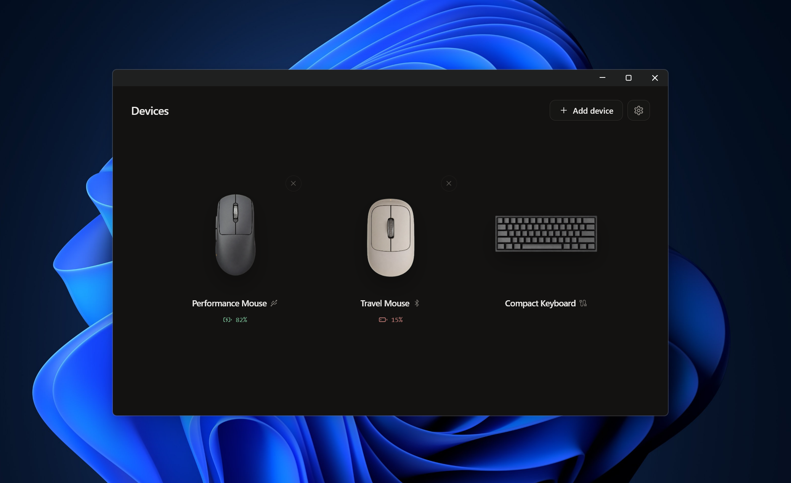
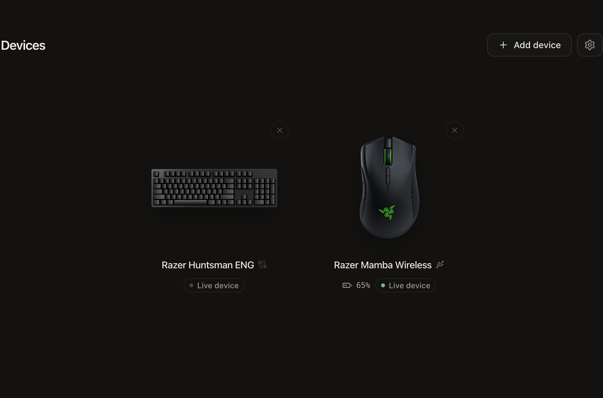
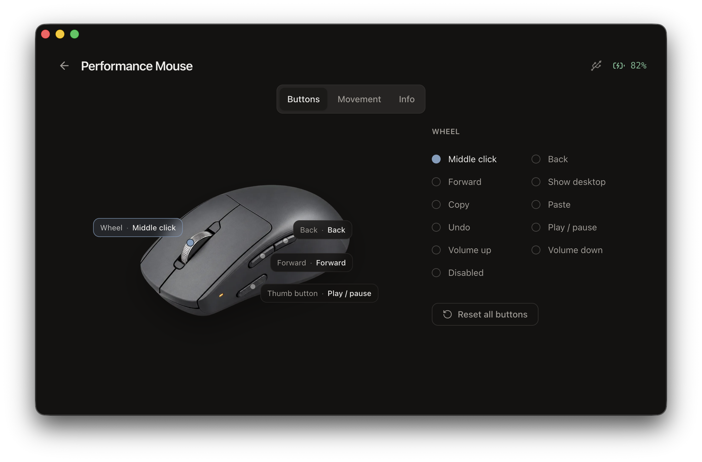
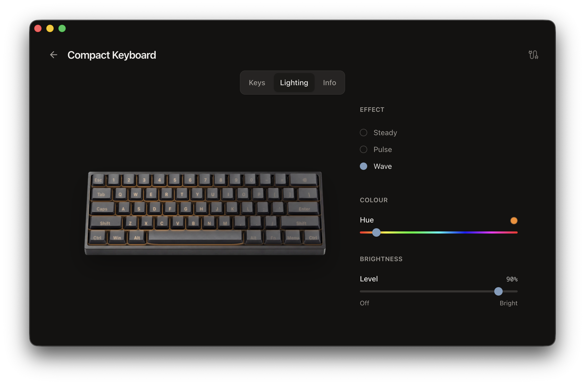
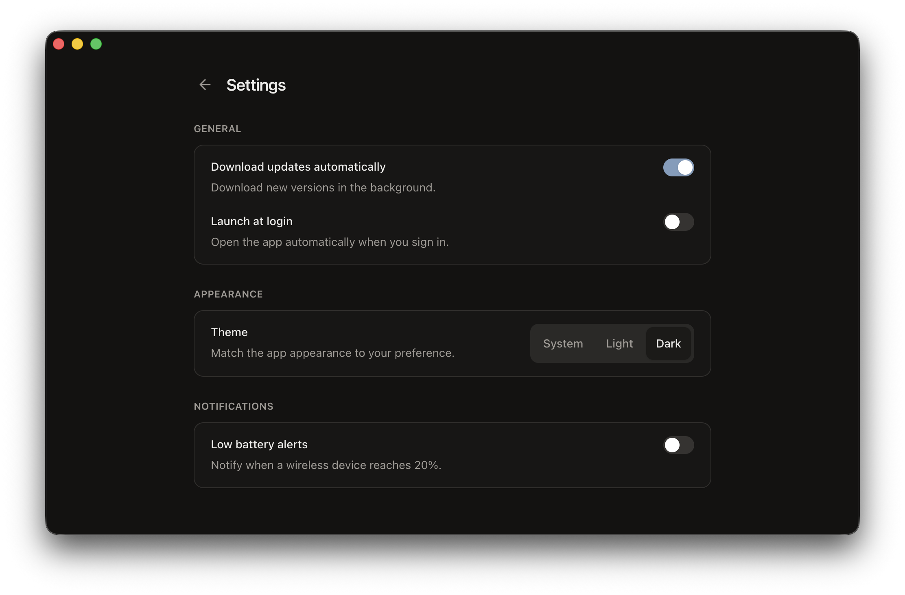

# MōDevice — a peripherals configuration demo

MōDevice is a small reference application for configuring mice and keyboards, built with
[MōBrowser](https://teamdev.com/mobrowser/). It shows how a React interface communicates with a TypeScript main process
that owns the device model, and a native C++ module that drives real keyboards and mice over HID.

<a href="assets/screenshots/windows-devices.png"></a>

## What the demo shows

- Find connected QMK/VIA keyboards and Logitech mice, add them, and remove them.
- See each device's connection, firmware, and a mouse's real battery level.
- Change a keyboard's backlight effect, color, and brightness, and a mouse's DPI.
- Change the app theme, launch it at login, manage updates, and enable low-battery alerts.
- Keep added devices between launches.

<p align="center">
  <a href="assets/screenshots/macos-devices.png"></a>
  <a href="assets/screenshots/macos-mouse-buttons.png"></a>
</p>

<p align="center">
  <a href="assets/screenshots/macos-keyboard-lighting.png"></a>
  <a href="assets/screenshots/macos-settings.png"></a>
</p>

The app supports QMK/VIA keyboards and Logitech mice connected through a Bolt receiver. When no
real device has been added, it shows clearly labelled dummy devices; **Add device** shows connected
hardware. This is a reference demo, not production device software.

The demo requires no account or API key. Packaged versions contact GitHub Releases to check for
updates, but device data and settings are not sent anywhere.

## Requirements

- macOS 14 or later on Apple silicon, Windows 10 or later on x64, or Linux on x64. See
  [Supported platforms](#supported-platforms).
- [Node.js](https://nodejs.org/en/download/) 20.20.2, 22.22.2, or 24.14.1 and later.
- [MōBrowser](https://teamdev.com/mobrowser/) 2.18.0 or later.

## Run from source

```bash
npm install
npm run dev
```

To create a production build:

```bash
npm run build
```

## Project structure

- `src/main/device-state.ts` owns the device list and settings: pairing, validation, and the
  keyboards and mice the native module reports.
- `src/main/via.ts` maps VIA hardware to app devices: known models, effects, and value ranges.
- `src/main/logitech.ts` maps Logitech mice to app devices.
- `src/main/devices.ts` connects the device state to the interface, the native module, and saved
  preferences.
- `src/native/hardware_service.*` serves the open keyboards and mice to the main process over
  native RPC.
- `src/native/via_keyboard.*` speaks the VIA protocol over HIDAPI.
- `src/native/hidpp_mouse.*` speaks Logitech's HID++ 2.0 protocol over HIDAPI.
- `src/native/platform/` holds everything that differs per operating system: `platform.h` and
  one implementation file per supported platform.
- `src/renderer/gateway/devices.ts` is the interface's single entry point for device operations.
- `src/renderer/components/device/` contains the shared device screen and the separate mouse and
  keyboard editors.
- `src/renderer/public/device-art/` contains the product images shown in the app.

## Supported platforms

| Platform | Platform file | HIDAPI backend | Device access | CI checks | Release | Tested with devices |
|---|---|---|---|---|---|---|
| macOS 14+, Apple silicon | [`mac.cc`](src/native/platform/mac.cc) | IOHIDManager | Nothing to set up | Yes | Yes, signed and notarized | Yes |
| Windows 10+, x64 | [`windows.cc`](src/native/platform/windows.cc) | WinAPI | Nothing to set up | Yes | No | No |
| Linux, x64 | [`linux.cc`](src/native/platform/linux.cc) | hidraw (needs `libudev-dev` to build) | Install [`70-modevice.rules`](src/native/platform/70-modevice.rules) | Yes | No | No |

All device code is shared. Only the functions declared in
[`src/native/platform/platform.h`](src/native/platform/platform.h) differ per platform, and
[`CMakeLists.txt`](CMakeLists.txt) compiles one implementation of them. Building on any other
platform stops with an error that points here.

On Linux, HID devices are readable only by root until a udev rule grants access. Run this once,
then plug the devices in again:

```bash
sudo cp src/native/platform/70-modevice.rules /etc/udev/rules.d/
sudo udevadm control --reload-rules && sudo udevadm trigger
```

## Connect real devices

The main process owns the app's device model; native code is a thin hardware adapter. Keep the
native contract coarse: one call lists the complete hardware state, one applies a complete setting,
and a callback sends a complete snapshot whenever hardware comes or goes. Do not expose one RPC per
SDK or HID command. See [`src/native/proto/devices.proto`](src/native/proto/devices.proto).

The demo saves the added devices and their last known settings in
[`src/main/devices.ts`](src/main/devices.ts), to show them while they are disconnected. Settings are
always read from the hardware when a device connects, never restored onto it.

### Add a device

**Another model of a supported kind** (a VIA keyboard or a mouse behind a Bolt receiver) needs
no native changes:

- For a VIA keyboard, add its vendor and product IDs and effect numbers to `KNOWN_MODELS` in
  [`src/main/via.ts`](src/main/via.ts). Without an entry it still works with Steady only.
- Optionally, add its artwork to `src/renderer/public/device-art/` and connect its `modelId` in
  [`device-art.tsx`](src/renderer/components/art/device-art.tsx). Without it, the device shows
  the default artwork for its kind.
- On Linux, add a line for a new vendor ID to
  [`70-modevice.rules`](src/native/platform/70-modevice.rules).

A new device protocol requires changes to the native driver, IPC contracts, main-process mapping,
and renderer. Run `npm run gen` after changing a `.proto` file.

## Download

You can download the app from the [releases page](https://github.com/mo-browser-apps/device/releases).
macOS releases are code-signed and notarized by Apple; Windows releases are code-signed.

## License

MIT — see [LICENSE](LICENSE).
